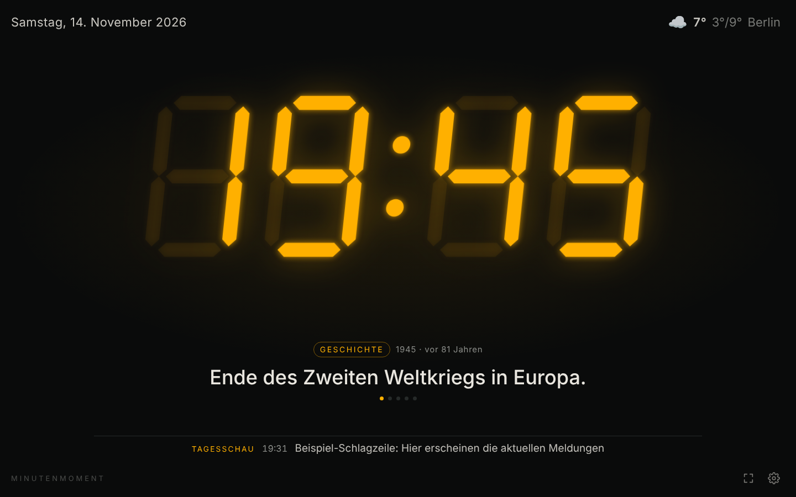

# Minutenmoment ⏱️

**Jede Minute eine Geschichte.**

👉 **Live-Version: https://tbr-brd.github.io/minutenmoment/**

Eine Uhr im LED-Look, die zu jeder Minute des Tages einen Fakt zeigt –
auf Deutsch: Geschichte, Kalenderdaten, Ereignisse genau zu dieser Uhrzeit, Mathe und Kurioses.

- **19:45** → *Geschichte · 1945 · vor 81 Jahren: Ende des Zweiten Weltkriegs in Europa.*
- **21:17** → *20. Juli 1969, 21:17 Uhr deutscher Zeit: „The Eagle has landed“.*
- **09:11** → *Kalenderblatt: Am 9. November – Schicksalstag der Deutschen.*
- **08:15** → *Null-acht-fünfzehn: benannt nach dem MG 08/15.*
- **17:29** → *1729 – die Taxi-Zahl von Ramanujan.*



Dazu optional **Datum** und **Wetter** (Open-Meteo, ohne API-Schlüssel) mit frei wählbarem Ort.

## Funktionen

| | |
|---|---|
| 🕰️ **LED-Uhr** | 7-Segment-Anzeige mit Ziffern-Scramble beim Minutenwechsel, 6 Farben |
| 📜 **Geschichte** | Uhrzeit als Jahreszahl (14:15 → 1415), als Datum (09:11 → 9. November) und Ereignisse, die genau zu dieser Uhrzeit geschahen |
| 🔢 **Mathe** | Primzahlen, Quadrat-/Kubikzahlen, Fibonacci, Palindrome, versteckte Rechnungen, Ziffernfolgen in π, e, √2 und φ |
| ☎️ **Kurioses** | Ortsvorwahlen (02:21 → Köln), Notrufnummern, bekannte Zahlen |
| 📅 **Datum** | z. B. „Samstag, 14. November 2026“ – abschaltbar |
| 🌤️ **Wetter** | aktuelle Temperatur, Tageshöchst-/-tiefstwert, Ort per Suche oder Standort – abschaltbar |
| ⭐ **Eigene Momente** | Geburtstage & Jahrestage; erscheinen zur passenden Uhrzeit (nur lokal im Browser gespeichert) |
| 📱 **Wanduhr-Modus** | Vollbild, Bildschirm wach halten, als App installierbar (PWA), offline nutzbar |

Bedienung: Auf den Fakt tippen oder <kbd>→</kbd> = nächster Fakt · <kbd>F</kbd> = Vollbild · <kbd>S</kbd> = Einstellungen

## Fakten erweitern

Alle kuratierten Daten stehen in [`tools/daten.py`](tools/daten.py):

- `JAHRE` – Jahreszahl → Ereignisse (nur Jahre, deren letzte zwei Ziffern < 60 sind, passen auf die Uhr)
- `TAGE` – (Tag, Monat) → Ereignisse (Tage 1–23, da die Stunde den Tag darstellt)
- `UHRZEIT_EREIGNISSE` – Dinge, die genau zu einer Uhrzeit passierten
- `BEKANNTE_ZAHLEN`, `VORWAHLEN`

Danach neu erzeugen (Python 3, keine Abhängigkeiten):

```bash
python3 tools/generate_facts.py
```

Das schreibt `data/facts.json` und `data/facts.js` neu (beide mit hochladen!). Mathe-Fakten (Primzahlen, π-Stellen usw.) berechnet das Skript selbst.

## Lokal testen

Einfach `index.html` per Doppelklick öffnen – oder mit lokalem Server:

```bash
python3 -m http.server 8000
# dann http://localhost:8000 öffnen
```

## Datenschutz

Keine Cookies, kein Tracking. Einstellungen und eigene Momente liegen nur im `localStorage` des Browsers.
Für das Wetter wird der eingestellte Ort (Koordinaten) an [Open-Meteo](https://open-meteo.com/) übermittelt.

## Inspiration & Lizenz

Inspiriert von der Idee hinter „Momentous“ von Andy Isaacson – Minutenmoment ist eine eigenständige,
deutschsprachige Neuumsetzung mit eigenen Daten und eigenem Code.

MIT-Lizenz © 2026 Thoralf Brandt
