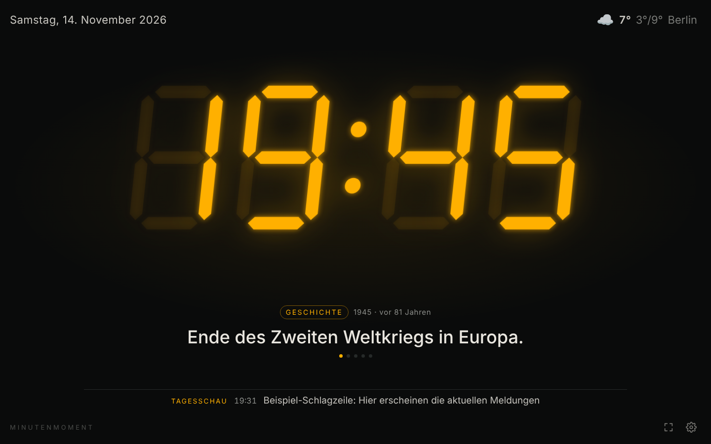

# Minutenmoment ⏱️

[🇩🇪 Deutsch](README.md) · 🇬🇧 English

**A story for every minute.** ("Minutenmoment" roughly means "minute moment".)

👉 **Live version: https://tbr-brd.github.io/minutenmoment/**

A clock in LED style that shows a fact for every minute of the day –
in German: history, calendar dates, events that happened at exactly this time, maths and curiosities.
Optionally also the **date**, **weather** and current **headlines**.

> The app itself and its facts are in German, with a focus on German history and culture.



- **19:45** → *History · 1945: end of the Second World War in Europe.*
- **21:17** → *20 July 1969, 21:17 German time: "The Eagle has landed".*
- **09:11** → *Calendar page: 9 November – Germany's "day of destiny".*
- **08:15** → *"Null-acht-fünfzehn" (German for "run-of-the-mill"): named after the MG 08/15 machine gun.*
- **17:29** → *1729 – Ramanujan's taxicab number.*

<br>
<a href="https://www.buymeacoffee.com/thoralf.brandt" target="_blank">
  
</a>
<br>

## Features

| | |
|---|---|
| 🕰️ **LED clock** | 7-segment display with digit scramble when the minute changes, 6 colors, optional seconds |
| 📜 **History** | Time as a year (14:15 → 1415), as a date (09:11 → 9 November) and events that happened at exactly this time – with "X years ago" |
| 🔢 **Maths** | Primes, squares/cubes, Fibonacci, palindromes, hidden equations, digit sequences in π, e, √2 and φ |
| ☎️ **Curiosities** | German area codes (02:21 → Cologne), emergency numbers, famous numbers |
| 📅 **Date** | e.g. "Samstag, 14. November 2026" |
| 🌤️ **Weather** | Current temperature, daily high/low; location by search or geolocation, °C/°F ([Open-Meteo](https://open-meteo.com/), no API key) |
| 📰 **Headlines** | tagesschau, Deutschlandfunk, SPIEGEL, ZEIT ONLINE, heise online or all mixed – rotating every 9 s, tap to open the article |
| ⭐ **Your own moments** | Birthdays & anniversaries appear at the matching time, and on the day itself next to the date |
| 📱 **Wall clock mode** | Full screen, keep screen awake, installable as an app (PWA), works offline |

Date, weather, headlines, seconds and fact rotation (never / 10–30 s) can each be switched on and off in the settings.

**Controls:** Tap the fact or <kbd>→</kbd> = next fact · <kbd>F</kbd> = full screen · <kbd>S</kbd> = settings

## Data

| Category | Size |
|---|---|
| Years (9 AD to 2038) | 261 years, 294 events |
| Calendar days | 76 days, 90 entries |
| Events to the exact minute | 26 |
| Famous numbers & area codes | 35 + 39 |
| Maths facts | computed for all 1,440 minutes |

About 340 minutes of the day have a historical link. Not every year fits on the clock:
only years whose last two digits are below 60 can be shown as a time – 1989, for example, can't,
so the fall of the Berlin Wall appears via the date instead (09:11 → 9 November).

## Project structure

```
index.html                 Page
css/style.css              Styling
js/app.js                  Clock, facts, weather, headlines, settings
data/facts.json|.js        Pre-computed facts (from tools/generate_facts.py)
tools/daten.py             Curated history data, numbers, area codes
tools/generate_facts.py    Generates the fact files
tools/fetch_news.py        Fetches the headlines (runs in the GitHub Action)
.github/workflows/pages.yml  Publishes the page, rebuilt every 30 minutes
sw.js, manifest.webmanifest  Offline cache and app installation
```

## Adding facts

Add new entries in [`tools/daten.py`](tools/daten.py):

- `JAHRE` – year → events
- `TAGE` – (day, month) → events (only days 1–23, because the hour represents the day)
- `UHRZEIT_EREIGNISSE` – things that happened at an exact time
- `BEKANNTE_ZAHLEN` (famous numbers), `VORWAHLEN` (area codes)

Then regenerate (Python 3, no dependencies) and commit both files in `data/`:

```bash
python3 tools/generate_facts.py
```

## Headline sources

The feeds are listed in `FEEDS` in [`tools/fetch_news.py`](tools/fetch_news.py) and can be extended there
(RSS or Atom). The GitHub Action fetches them on every push and every 30 minutes; a feed that doesn't respond
is skipped. Whether all sources deliver is shown in the workflow log under **Actions**.

Requirement: **Settings → Pages → Source: "GitHub Actions"**.

## Testing locally

Open `index.html` by double-clicking – clock, facts and weather work right away.
Headlines are only available online, because `data/news.json` is generated by the GitHub Action.
To see them locally:

```bash
python3 tools/fetch_news.py
python3 -m http.server 8000   # then open http://localhost:8000
```

## Privacy

No cookies, no tracking. Settings and your own moments are stored only in the browser's `localStorage`.
For the weather, the chosen location (coordinates) is sent to [Open-Meteo](https://open-meteo.com/).
Headlines are not fetched by the browser but by the GitHub Action from the newsrooms' public RSS feeds;
only the title, time and a link to the original article are shown.

## Inspiration & license

Inspired by the idea behind "Momentous" by Andy Isaacson – Minutenmoment is an independent,
German-language reimplementation with its own data and its own code.

MIT License © 2026 Thoralf Brandt
